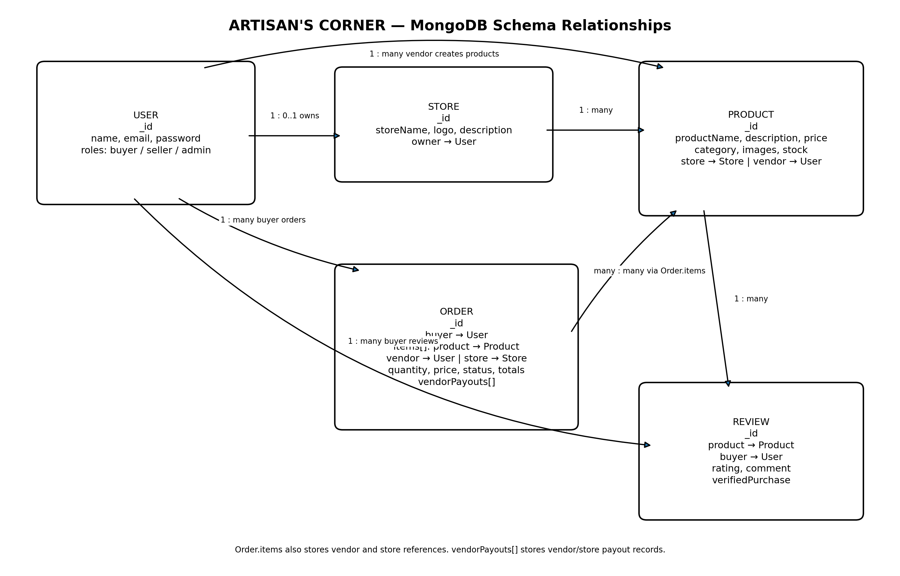

# Artisan's Corner 🧶

A multi-vendor e-commerce marketplace for handmade products, connecting talented artisans with customers who appreciate unique, handcrafted goods.

## 📌 Project Overview

Artisan's Corner is a full-stack e-commerce web application where vendors can create their own stores, manage handmade products, and track their sales. Buyers can explore products, add items to their cart, place orders, and review products after purchasing them.

The platform also includes an admin dashboard for monitoring users, vendors, products, orders, sales, and platform commission.

## ✨ Features

### 👤 User Authentication
- User registration and login.
- JWT-based authentication.
- Role-based access control.
- Support for Buyer, Seller, and Admin roles.

### 🛍️ Buyer Features
- Browse available handmade products.
- View individual product details.
- Add products to the shopping cart.
- Update product quantities and remove items.
- Persistent cart using localStorage.
- Checkout with shipping details.
- View order history.
- Submit product reviews after a verified purchase.

### 🏪 Vendor Features
- Vendor onboarding and store creation.
- Create, update, and delete products.
- Upload product images using Cloudinary.
- Manage product inventory.
- View vendor dashboard.
- Track sales history and total earnings.

### ⭐ Product Reviews
- Submit ratings from 1 to 5 stars.
- Add written reviews.
- Verified-purchase validation.
- Display customer reviews.

### 👨‍💼 Admin Features
- Admin dashboard.
- View total users and vendors.
- Monitor stores and products.
- View total stock.
- Monitor total, paid, pending, and failed orders.
- Track total sales and platform commission.

### 📦 Order Management
- Create orders.
- Store shipping information.
- Track payment and order status.
- Calculate a 5% platform commission and 95% vendor payout.

**Note:** The current local demo uses simulated payment processing. It does not charge real money or perform actual vendor transfers.

## 🛠️ Technology Stack

### Frontend
- React.js
- Vite
- React Router
- Context API
- CSS
- Axios
- localStorage

### Backend
- Node.js
- Express.js
- MongoDB
- Mongoose
- JSON Web Tokens (JWT)
- bcrypt
- Cloudinary

### Development Tools
- Visual Studio Code
- Postman
- Git
- GitHub

## 📂 Project Structure

```text
artisans-corner/
│
├── backend/
│   ├── config/
│   ├── controllers/
│   ├── middleware/
│   ├── models/
│   ├── routes/
│   ├── .env
│   └── server.js
│
├── frontend/
│   ├── public/
│   ├── src/
│   │   ├── components/
│   │   ├── context/
│   │   ├── pages/
│   │   ├── services/
│   │   └── App.jsx
│   └── package.json
│
├── doc/
│   └── artisans_corner_database_schema.png
│
└── README.md
```

## 🗄️ Database Models

The application uses MongoDB with the following main models:

| Model | Purpose |
|---|---|
| User | Stores user details and roles. |
| Store | Stores vendor store information. |
| Product | Stores handmade product details. |
| Order | Stores customer orders and payment information. |
| Review | Stores product ratings and customer reviews. |

## 📊 Database Schema



## ⚙️ Installation and Setup

### Prerequisites

- Node.js and npm
- MongoDB Atlas account
- Cloudinary account
- Git

### 1. Clone the Repository

```bash
git clone https://github.com/deepika1307-alt/artisans-corner.git
```

### 2. Navigate to the Project

```bash
cd artisans-corner
```

### 3. Backend Setup

```bash
cd backend
npm install
```

Create a `.env` file inside the backend folder and configure the following variables:

```env
PORT=5000
MONGO_URI=your_mongodb_connection_string
JWT_SECRET=your_jwt_secret
JWT_EXPIRES_IN=your_jwt_expiration
CLOUDINARY_CLOUD_NAME=your_cloudinary_cloud_name
CLOUDINARY_API_KEY=your_cloudinary_api_key
CLOUDINARY_API_SECRET=your_cloudinary_api_secret
NODE_ENV=development
FRONTEND_URL=your_frontend_url
```

Start the backend:

```bash
npm run dev
```

### 4. Frontend Setup

Open a new terminal:

```bash
cd frontend
npm install
```

Create a `.env` file in the frontend folder:

```env
VITE_API_URL=http://localhost:5000/api
```

Start the frontend:

```bash
npm run dev
```

Open the local URL displayed in the terminal to access the application.

## 💰 Commission Structure

The platform follows this commission structure:

| Description | Percentage |
|---|---:|
| Platform Commission | 5% |
| Vendor Payout | 95% |

The commission and vendor payout amounts are calculated for each vendor's share of an order.

## 🔐 Security

- Password hashing.
- JWT-based authentication.
- Protected routes.
- Role-based authorization.
- Environment variables for sensitive credentials.
- `.env` files excluded from Git.

**Important:** Never upload API keys, passwords, JWT secrets, or database connection strings to GitHub.

## 🚀 Deployment

The application is deployed using:

- Render for backend hosting.
- Render Static Sites for frontend hosting.
- MongoDB Atlas for database hosting.
- Cloudinary for product image storage.

Live Application: *Add your deployed frontend URL here.*

## 👩‍💻 Developer

Developed as an internship project.

**Project Name:** Artisan's Corner
**Category:**Full-Stack Web Development
**GitHub Repository:** https://github.com/deepika1307-alt/artisans-corner

---
*Artisan's Corner — Bringing handmade creativity closer to everyone.*